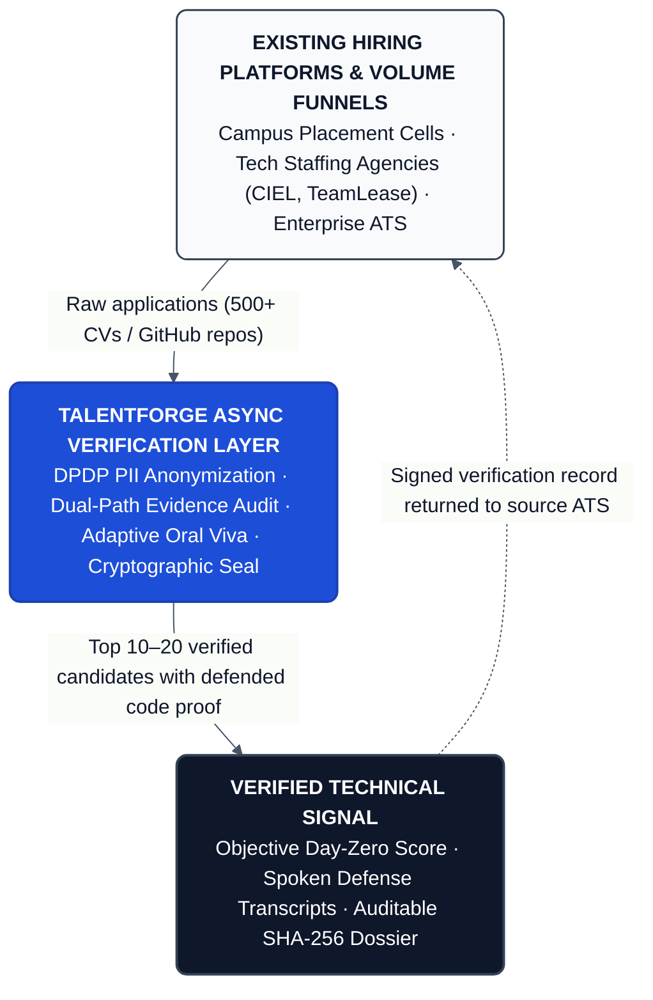
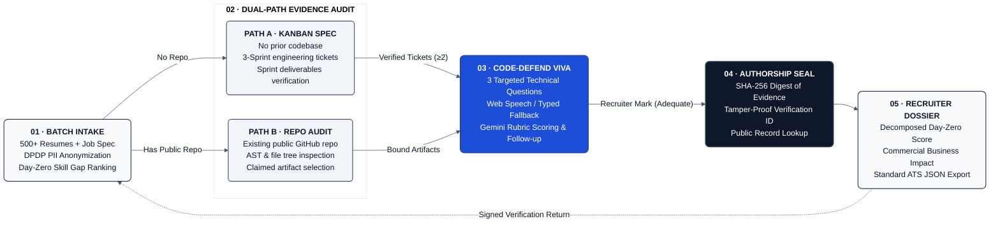

# TalentForge: Technical Verification Infrastructure for Existing Hiring Platforms

### Async Code-Defend Funnel for High-Volume Campus Drives

[](https://talentforge.alqatech.in)
[](#1-the-problem-high-volume-campus-signal-crisis)
[](#hackathon-submission-dossier)
[](https://fastapi.tiangolo.com/)
[](https://ai.google.dev/)
[](https://reactrouter.com/)
[](https://tailwindcss.com/)
[](https://www.meity.gov.in/)
[](#5-human-centered-design--accessibility-safeguards)
[](#hackathon-submission-dossier)

> **"We don't replace hiring platforms. We make them better at verifying technical talent."**  
> **One-Sentence Summary:** TalentForge turns high-volume, low-signal campus applications into a shortlist of candidates who have already defended their own technical work, then returns a clean, auditable verification package to the recruiter and the existing hiring platform.

* **Live Hosted Prototype:** [https://talentforge.alqatech.in](https://talentforge.alqatech.in)  
* **Domain Selection:** Skill Gap & Youth Employability  
* **Event & Track:** Founder's Code 2026 (24-Hour National Build Sprint) · Skill Gap & Youth Employability  
* **Primary User:** Recruiter / Talent Acquisition (Campus Placement Officers, Staffing Agency Recruiters, Enterprise TA)  
* **Team AlqaTech:**
  * **Izzadhin Al Qassam A S** (Tech Track · SMIT, MBA in AI & Data Science)
  * **Hanadi Al Jaradath A S** (Business Track · BSc in Computer Science)

---

## 1. The Problem: High-Volume Campus Signal Crisis

Campus hiring and high-volume technical recruitment face a structural signal breakdown:

* **The 500-CV Volume Flood:** Hundreds of applications arrive for every campus drive. Recruiters have under 48 hours to filter candidates, forcing reliance on blunt keyword searches and GPA cutoffs.
* **The AI Evidence Illusion:** Generative AI assistants allow anyone to scaffold production-looking repositories, solve LeetCode puzzles, and polish resumes without comprehending core engineering trade-offs.
* **Automated Tests Are Gamed:** Traditional HackerRank and textbook algorithm tests are easily bypassed with AI tooling and measure rote memorization rather than Day-Zero operational execution.
* **Generic Video Interviews Lack Substance:** One-way video prompts test rehearsed speech rather than code comprehension and are completely detached from what the candidate actually built.
* **The Strongest Signal Does Not Scale:** A live architectural defense of one's own code and design decisions is the single highest-fidelity hiring signal, but running live technical vivas with senior engineers for 500 applicants is logistically and economically impossible.
* **The Engineering Drain:** Non-technical recruiters lack the code-auditing background to evaluate repositories. As a result, senior engineers waste 100+ hours per hiring season conducting Round-1 technical screens on candidates who collapse under basic architectural questioning.

**The Result:** High false-positive rates, persistent Day-Zero skill gaps among new hires, and an expensive, low-signal interview cycle where recruiters are forced to choose between volume and evaluation depth.

---

## 2. The Solution: 'Attach, Don't Compete' Verification Layer

TalentForge is an asynchronous technical verification layer that sits directly on top of existing Applicant Tracking Systems (ATS), campus placement portals, and staffing agency workflows. 

**It does not replace existing hiring platforms.** It enhances them by inserting a targeted technical verification step after initial CV screening and before senior engineer interviews.

> *Figure 1 — System positioning: TalentForge as an integrated technical verification layer within existing recruitment workflows.*



### Value by Stakeholder

* **For Candidates:** An authentic, LeetCode-free platform to demonstrate real engineering comprehension by explaining the architectural choices behind their code.
* **For Recruiters & Placement Cells:** High-speed batch processing that turns an overwhelming pool of resumes into an objective, ranked shortlist with verified technical evidence.
* **For Hiring Managers & Engineers:** Senior engineers only spend interview hours with candidates who have already proven they can defend their code.

---

## 3. The 5-Step Verification Funnel

TalentForge structures verification into a 5-step funnel featuring dual-path evidence routing:

> *Figure 2 — The TalentForge 5-step technical verification funnel with dual-path evidence audit.*



### Funnel Steps in Detail

1. **Screen 1 · Batch Intake & Skill-Gap Filter:** Ingests batches of candidate resumes against a target job description. Automatically strips personally identifiable information (PII) before model analysis, performs structured skill-gap analysis, and produces a ranked shortlist of high-potential candidates.
2. **Screen 2 · Dual-Path Evidence Audit:**
   * **Path A (3-Sprint Kanban Spec):** For candidates without existing public code, the system generates a role-specific 3-sprint proof-of-work engineering roadmap (Schema, APIs, Deployment) addressing their specific skill gaps.
   * **Path B (Repository Evidence Audit):** For candidates with a public GitHub repository, the system performs a lightweight inspection (README, file tree, selected file contents) via the GitHub REST API to bind concrete code artifacts for defense.
3. **Screen 3 · Code-Defend Oral Viva:** Dynamically generates 3 targeted technical questions anchored strictly in the candidate's claimed artifacts:
   * *Q1 (Architectural Deep Dive):* Probes structural choices and component boundaries.
   * *Q2 (Concurrency / Failure Trade-off):* Probes edge cases, error recovery, and transaction rollbacks.
   * *Q3 (Requirement Mutation Stress Test):* Changes a business constraint to test how the candidate adapts the architecture.
   * *Execution Modes:* Live browser speech recognition for hackathon demonstration; asynchronous candidate recording queue for campus-drive volume.
4. **Screen 4 · Shortlist Decision & Cryptographic Authorship Seal:** The recruiter reviews spoken/typed transcripts and accepts or overrides the advisory AI score. Candidates who pass receive a tamper-evident Authorship Seal—a canonical SHA-256 hash binding candidate metadata, verified deliverables, and viva scores into a unique ID (`TF-SEAL-YYYYMMDD-XXXXXXXX`).
5. **Screen 5 · Recruiter Verification Dossier:** Compiles an executive verification report featuring a decomposed Day-Zero readiness score (40% Viva Depth + 35% Evidence Strength + 25% Gap Coverage), plain-English commercial business impact translations, and an exportable JSON payload ready for ATS ingestion.

---

## 4. How TalentForge Helps Recruiters & Talent Acquisition

| Recruiter Pain Point | How TalentForge Solves It |
| :--- | :--- |
| **Too many CVs, too little signal** | Automated batch ingestion + skill-gap filtering narrows 500+ raw resumes down to an objective, manageable shortlist. |
| **AI-inflated portfolios & resumes** | Candidates must orally defend concrete architectural trade-offs in their claimed code; LeetCode memorization and copy-pasted code fail immediately. |
| **Non-technical screeners cannot evaluate code** | Automated business-impact translations convert technical code deliverables into clear commercial value and risk-mitigation summaries. |
| **Senior engineer interview time is expensive** | Senior engineers only interview candidates who have already passed an oral defense of their work, reducing Round-1 interview load by 80%. |
| **No audit trail or verification proof** | SHA-256 cryptographic authorship seal and portable verification ID create an immutable audit record for compliance and client billing. |
| **Volume vs. quality trade-off** | Live oral viva operates for immediate evaluations; asynchronous candidate recording operates at campus-drive scale. |
| **Data privacy & bias concerns** | Automated PII anonymization before model inference satisfies DPDP Act 2023 Section 8; human recruiter maintains 100% final hiring authority. |

---

## 5. Human-Centered Design & Accessibility Safeguards

TalentForge is engineered to ensure ethical, transparent, and fair hiring across diverse candidate pools:

* **Dual-Layer PII Anonymization (DPDP Act 2023):** Client-side (`frontend/app/lib/pii.ts`) and server-side (`backend/core/pii.py`) multi-pattern regex engines redact names, emails, phone numbers, colleges, and locations before any prompt touches the LLM. This guarantees blind evaluation and prevents unconscious demographic bias.
* **Speech-to-Text Fairness & Regional Accent Safeguards:** Indian campus drives feature diverse linguistic accents and acoustic environments. To prevent speech-to-text exclusion, TalentForge ensures:
  1. The AI evaluation score is **strictly advisory**.
  2. The human recruiter always reviews the transcript and applies the **authoritative final mark** (`adequate`, `weak`, `none`).
  3. A **Deterministic Typed Fallback Mode** is always available with transparent scoring disclosures for candidates with hardware limitations, speech differences, or noisy test halls.
* **Reviewer Fatigue Mitigation:** Structured 3-question transcripts with highlighted rubric evidence citations and a 1-click evaluation interface allow recruiters to review a candidate's defense in under 90 seconds.
* **High-Contrast "Quiet Compliance Desk" Interface:** Designed for clarity and low visual fatigue. All UI colors, card boundaries, and diagrams strictly meet WCAG 2.1 AA standards (minimum 4.5:1 text-to-background contrast; >7:1 for diagram nodes and borders). Status indicators never rely on color alone, pairing color hues with explicit text badges.

---

## 6. Technical Architecture & Implementation State

### Architecture Pipeline

TalentForge is architected as an asynchronous, event-driven micro-pipeline:

```
[Candidate / Recruiter Client] 
     │ (React Router v7 SPA · Web Speech API · SessionStorage)
     ▼
[FastAPI Gateway on Granian :8000]
     │ (Async Python · Token-bucket rate limiting · Pydantic v2 validation)
     ▼
[DPDP PII Anonymizer Engine] 
     │ (Regex engine · Ephemeral in-memory scrubbing · Zero persistent PII)
     ▼
[Evidence Engine & Public GitHub API] 
     │ (Lightweight inspection: README, file tree, selected contents · No deep clone)
     ▼
[Google Gemini 2.5 Flash] 
     │ (Structured JSON schemas: skill gaps, specs, targeted viva questions, rubrics)
     ▼
[SHA-256 Cryptographic Seal & Verification Lookup]
     │ (Canonical JSON digest · Public verification endpoint GET /v1/verify/{id})
     ▼
[Exportable Dossier & ATS Return]
```

### Working Prototype vs. Production Roadmap

| System Layer | Current Working Prototype | Enterprise Production Roadmap |
| :--- | :--- | :--- |
| **AI Intelligence** | **Google Gemini 2.5 Flash** using official `google-genai` SDK with strict Pydantic v2 schemas. | Sovereign 7B SLM hosted on private cloud VPC or dedicated Gemini Enterprise instance. |
| **Voice Processing** | **Browser Web Speech API** with live transcription and deterministic typed fallback. | WebSocket streaming audio to Whisper with raw audio archival and voiceprint verification. |
| **Code Inspection** | **GitHub REST API Inspection** (languages, stars, file tree, snippets, pre-seeded demo profiles). | Ephemeral Docker sandbox executing candidate test suites and static AST analysis. |
| **Data Persistence** | **Stateless & In-Memory:** Client `sessionStorage` (Zustand) and FastAPI in-memory verification cache. | PostgreSQL / Supabase with Row-Level Security (RLS) and immutable audit logs. |
| **Authentication** | **Open Workbench:** Rapid hackathon evaluation without sign-in friction. | Enterprise SSO (Okta, Google Workspace, Azure AD) with RBAC (Recruiter vs. Engineering Manager). |
| **ATS Integration** | **Simulated Integration:** Recruiter copies/pastes JSON payloads or uses pre-seeded campus drive datasets. | Bidirectional webhooks and REST connectors for Greenhouse, Lever, Workday, and Darwinbox. |
| **Candidate Flow** | **Recruiter-Driven Demo Mode:** Candidate voice defense conducted directly in the workbench console. | Async candidate portal with self-recording links, time-limited tokens, and mobile support. |

---

## 7. Business Model & Go-to-Market Strategy

### Target Customers
* **High-Volume Campus Placement Teams:** Engineering colleges (e.g., SMIT and regional universities) seeking higher placement conversion with Tier-1 tech recruiters.
* **Tech Staffing Agencies:** Firms like CIEL, TeamLease, and boutique tech recruitment agencies whose billable margins depend on delivering pre-vetted, high-signal shortlists quickly.
* **Mid-to-Large Tech Employers:** Companies processing hundreds of entry-level applications per recruitment drive.

### Value Unit & Pricing Architecture
* **Pay-Per-Verification (Transactional):** ₹500 – ₹800 per candidate dossier. Ideal for boutique agencies vetting final candidate batches.
* **Campus Drive Bundle:** ₹25,000 per campus drive pass (covers up to 200 candidate evaluations).
* **Enterprise ATS Connector:** Annual subscription tier providing white-labeled verification API access.

### GTM Strategy: 'Attach, Don't Compete'
1. **Pilot inside existing campus drives:** Partner with university placement cells and staffing firms to run verification on existing applicant pools.
2. **Benchmark engineering hours saved:** Prove that Round-1 interview pass rates jump from 40% to 85% while cutting senior engineer interview hours by 80%.
3. **Channel Distribution via Staffing Platforms:** Attach TalentForge directly to staffing agencies that already own high-volume candidate distribution, turning verification into a value-add service.

---

## 8. Key Challenges & Explicit Mitigations

* **Speech-to-Text & Regional Accent Fairness:** Non-native accents can degrade speech-to-text accuracy.  
  *Mitigation:* The AI score is strictly an advisory suggestion with full rubric rationale. The human recruiter always reviews the transcript and applies the final mark. A deterministic typed fallback mode is always provided.
* **Candidate Completion Rates on Async Tasks:** Candidates drop off if take-home tasks are too long.  
  *Mitigation:* Async oral defenses are capped at 3 targeted questions taking under 7 minutes total, coordinated through campus placement cell deadlines.
* **Reviewer Fatigue:** Recruiters cannot spend hours reading transcripts.  
  *Mitigation:* Short, structured transcripts with direct rubric hit/miss citations and a 1-click marking interface reduce review time to under 90 seconds per candidate.
* **Live Viva Scaling to Hundreds of Applicants:** Live interviewer sessions cannot scale to 500 candidates.  
  *Mitigation:* The live viva operates for hackathon demonstration and final executive rounds; asynchronous self-recording is the designated production path for volume.
* **LLM & Network Instability During Live Demos:** Unreliable auditorium WiFi can stall external API calls.  
  *Mitigation:* Strict 4-second timeouts, rate-limiting guards, and pre-cached golden path profiles (`aarav-sharma`, `priyanair`, `kavita-r`) ensure the application never hangs.
* **Scope Discipline:** Building a full ATS replacement during a 24-hour sprint leads to half-baked tools.  
  *Mitigation:* TalentForge strictly limits scope to the verification layer, proving the core funnel with high fidelity while cleanly defining enterprise roadmap extensions.

---

## 9. Local Quickstart Guide

### Prerequisites
* **Node.js** v20+ or v22+
* **Python** 3.12+ (or managed via `uv`)
* **Google Gemini API Key** (configured in `backend/.env`)

### Fast Start (Both Servers via Runner)

```bash
# 1. Clone repository
git clone https://github.com/your-username/talent-forge.git
cd talent-forge

# 2. Launch both FastAPI (port 8000) and Vite (port 5173)
./dev.sh
```

### Manual Service Startup

**Backend (FastAPI + Granian ASGI):**
```bash
cd backend
uv venv
source .venv/bin/activate
uv pip install -r pyproject.toml
uv run python main.py
```
*API running at `http://127.0.0.1:8000` (Interactive Swagger Docs: `http://127.0.0.1:8000/docs`)*

**Frontend (React Router v7 + Vite):**
```bash
cd frontend
npm install
npm run dev
```
*Frontend running at `http://localhost:5173` (Proxies `/v1` requests to backend on port 8000)*

---

## 10. Project Directory Layout

```
talent-forge/
├── .slides/                       # 12-Slide Pitch Deck (HTML + CSS presentation)
│   ├── index.html                 # Master presentation deck
│   └── slides_content.md          # Pitch script & slide narrative
├── backend/                       # Stateless Python FastAPI microservice
│   ├── core/                      # Core configuration, LLM caller, PII sanitizer
│   │   ├── config.py              # Environment configuration & rate limits
│   │   ├── llm.py                 # Google Gemini 2.5 Flash structured client
│   │   └── pii.py                 # Multi-pattern regex engine (DPDP Act 2023)
│   ├── src/                       # Feature routers and services
│   │   ├── intake/                # Batch & single resume parsing with skill gaps
│   │   ├── kanban/                # 3-sprint engineering spec generator
│   │   ├── viva/                  # Oral viva generation & defense evaluation
│   │   ├── seal/                  # SHA-256 cryptographic seal & verification lookup
│   │   ├── dossier/               # Executive dossier & commercial impact builder
│   │   ├── repo/                  # Public GitHub API repository inspection
│   │   └── router.py              # Central API router (/v1)
│   ├── main.py                    # Granian ASGI entrypoint (port 8000)
│   └── pyproject.toml             # Python dependencies
├── frontend/                      # React Router v7 + Tailwind CSS v4 SPA
│   ├── app/
│   │   ├── components/            # UI components (Intake, Kanban, Layout, UI)
│   │   ├── lib/                   # API client, PII sanitizer, demo presets
│   │   ├── routes/                # 5-screen application routes
│   │   │   ├── _index.tsx         # Screen 1: Batch Intake & Skill-Gap Filter
│   │   │   ├── kanban.tsx         # Screen 2A: 3-Sprint Engineering Spec Board
│   │   │   ├── repo-analysis.tsx  # Screen 2B: GitHub Repository Evidence Audit
│   │   │   ├── viva.tsx           # Screen 3: Code-Defend Oral Viva Engine
│   │   │   ├── seal.tsx           # Screen 4: Cryptographic Authorship Seal
│   │   │   └── dossier.tsx        # Screen 5: Verification Dossier & ATS Export
│   │   └── stores/
│   │       └── sessionStore.ts    # Zustand sessionStorage state management
│   ├── package.json               # Node.js dependencies
│   └── vite.config.ts             # Vite configuration with /v1 backend proxy
├── dev.sh                         # Dual-server local development script
├── prod.sh                        # Production server startup script
└── README.md                      # Project documentation and architectural dossier
```

---


## License
Distributed under the MIT License. See `LICENSE` for more information.
